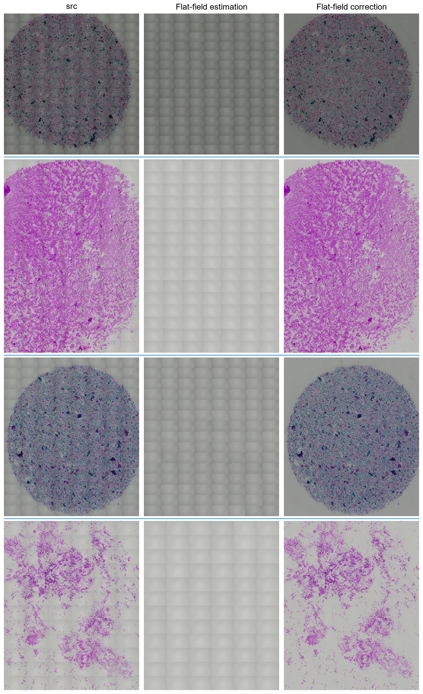

# Learning Image-Adaptive Illumination Bases for Single-Image Flat-Field Correction in Bright-Field Microscopy

**LAIBNet** — official implementation: single-image flat-field correction for bright-field microscopy.

LAIBNet estimates the multiplicative illumination component (the flat field) directly from a single unevenly illuminated image, then recovers the corrected image by dividing by that estimate. No calibration target, no multi-frame acquisition and no reference flat-field image are needed at inference time.

> **Status.**
>
>  The accompanying manuscript is under review. Code, pretrained weights and qualitative results are released for reproducibility; quantitative comparison tables will be added after acceptance. Contents may change before publication.

**Keywords:** Image-Adaptive Illumination Bases · flat-field correction · flat field image

## Overview




From left to right: the acquired image (`src`), the illumination field estimated by LAIBNet, and the corrected image. Each row is one whole-slide image. The block-wise shading visible in `src` is captured by the estimated flat field and removed in the correction, while the specimen signal is preserved.

## Repository layout


```
LAIBNet/
├── main.py                  # entry point + all training arguments
├── train.py                 # training loop, loss, checkpointing
├── test.py                  # inference on tiled WSI patches, saves outputs
├── requirements.txt         # Python dependencies
├── .gitignore
├── models/
│   └── LAIBNet.py           # Conv / Down / FCIC / FCICU / LAIBNet (+ optional FLOPs script)
├── data/
│   ├── __init__.py
│   └── data_load.py         # CorrectionDataset, train/test dataloaders
├── pytorch_msssim/          # vendored MS-SSIM implementation (no pip dependency)
├── weights/
│   └── Final_epoch_320.pkl  # released checkpoint (320 epochs)
├── imgs/                    # composed qualitative overview (individual frames omitted)
│   └── overview.jpg         # figure shown above
└── dataset/
    ├── train/               # src / GTC / GTF
    └── test/                # one folder per WSI, tiled patches
```

## Dataset format

Every split is a folder containing three sub-folders with **identical file names**:


| Folder | Meaning                                                               |
| ------ | --------------------------------------------------------------------- |
| `src/` | raw acquired image with uneven illumination (network input)           |
| `GTC/` | ground-truth **corrected** image (target of `Ŝ`)                      |
| `GTF/` | ground-truth **flat field** / illumination component (target of `F̂`) |


```
dataset/
├── train/
│   ├── src/   1.jpg ...
│   ├── GTC/   1.jpg ...
│   └── GTF/   1.jpg ...
└── test/
    └── WSI1/
        ├── src/      1047065.jpg ... 1047184.jpg   (120 tiles)
        ├── GTC/      1047065.jpg ...
        ├── GTF/      1047065.jpg ...
        └── WSI.txt   tile order within the WSI
```

The `dataset/` folder in this repository is a **small demo subset** for smoke-testing the pipeline, not the full benchmark: one training sample and one test WSI (`WSI1`, 120 tiles). The complete paired dataset (blood, cervical TCT and other brightfield modalities) is available from the authors on reasonable request.

Patches are trained and evaluated at 600 × 960. Any size divisible by 8 is accepted; non-divisible sizes are handled by explicit padding in `Down`.

## Installation

Python ≥ 3.9 is required, since `torch.fft` is used throughout.


```
git clone https://github.com/CV-AI-WORLD/LAIBNet.git
cd LAIBNet

conda create -n laibnet python=3.10 -y
conda activate laibnet

pip install -r requirements.txt   # use a CUDA-enabled torch build for training
```

There is no external MS-SSIM dependency — `pytorch_msssim` is vendored in the repository.

Environment used for the reported run: Python 3.13, PyTorch 2.9.0 + CUDA 12.8, OpenCV 5.0, NumPy 2.5.

**A CUDA device is mandatory for training**: `main.py` calls `_train()` only when `torch.cuda.is_available()` is true.

## Training


```
python main.py \
    --data_dir ./dataset \
    --batch_size 10 \
    --learning_rate 0.0005 \
    --num_epoch 320 \
    --num_worker 6 \
    --model_save_dir ./weights
```

`--model_save_dir` must already exist; checkpoints are written every 10 epochs as `Final_epoch_<N>.pkl`. Resume from any checkpoint with `--resume ./weights/Final_epoch_320.pkl`.


| Setting       | Value                                                  |
| ------------- | ------------------------------------------------------ |
| Optimizer     | Adam, `weight_decay = 0`                               |
| Learning rate | 5e-4                                                   |
| LR schedule   | `MultiStepLR`, γ = 0.8, decay at epochs 40, 80, …, 320 |
| Epochs        | 320                                                    |
| Batch size    | 10                                                     |
| Input         | 600 × 960 RGB patches, values in `[0, 1]`              |
| Augmentation  | none (random shuffling only)                           |
| Hardware      | single GPU                                             |

## Inference


```
python test.py \
    --test_model ./weights/Final_epoch_320.pkl \
    --test_data_dir ./dataset/test
```

Both arguments default to the values shown above (`./weights/Final_epoch_320.pkl` and `./dataset/test`), so `python test.py` alone reproduces the demo run.

For every WSI sub-folder, two output folders are created next to `src/`:


* `LAIBNet_flat/` — the predicted illumination field `F̂`

* `LAIBNet_correction/` — the corrected image `I / F̂ · mean(F̂)`

Both are clipped to `[0, 1]`, saved as 8-bit RGB with the original file name, and the per-patch inference time (in ms) is printed. The script runs one 600 × 960 warm-up pass before timing.

## Acknowledgements

The MS-SSIM implementation under `pytorch_msssim/` is a vendored copy of [pytorch-msssim](https://github.com/VainF/pytorch-msssim); please cite the original work if you use it. FLOPs counting optionally uses [thop](https://github.com/Lyken17/pytorch-OpCounter).

## License

Released for academic and research use. For commercial licensing, please contact the authors.

## Citation


```
@misc{laibnet2026,
  title        = {Learning Image-Adaptive Illumination Bases for Single-Image
                  Flat-Field Correction in Bright-Field Microscopy},
  howpublished = {\url{https://github.com/CV-AI-WORLD/LAIBNet}},
  year         = {2026},
  note         = {Manuscript under review}
}
```

The reference will be updated once the paper is accepted; until then please cite the repository directly.